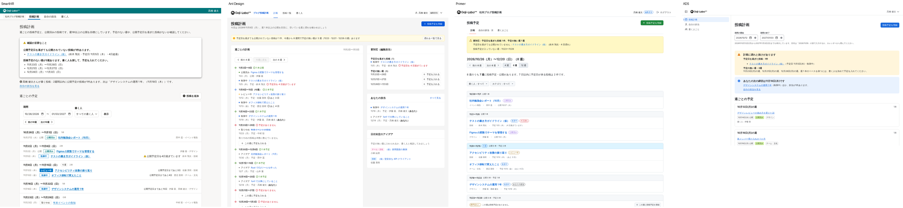
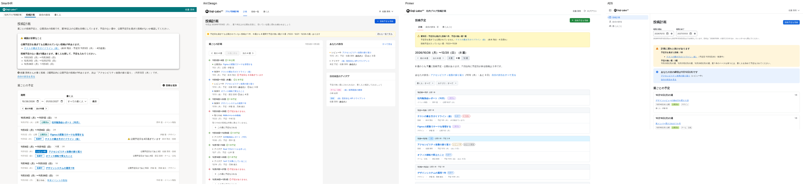
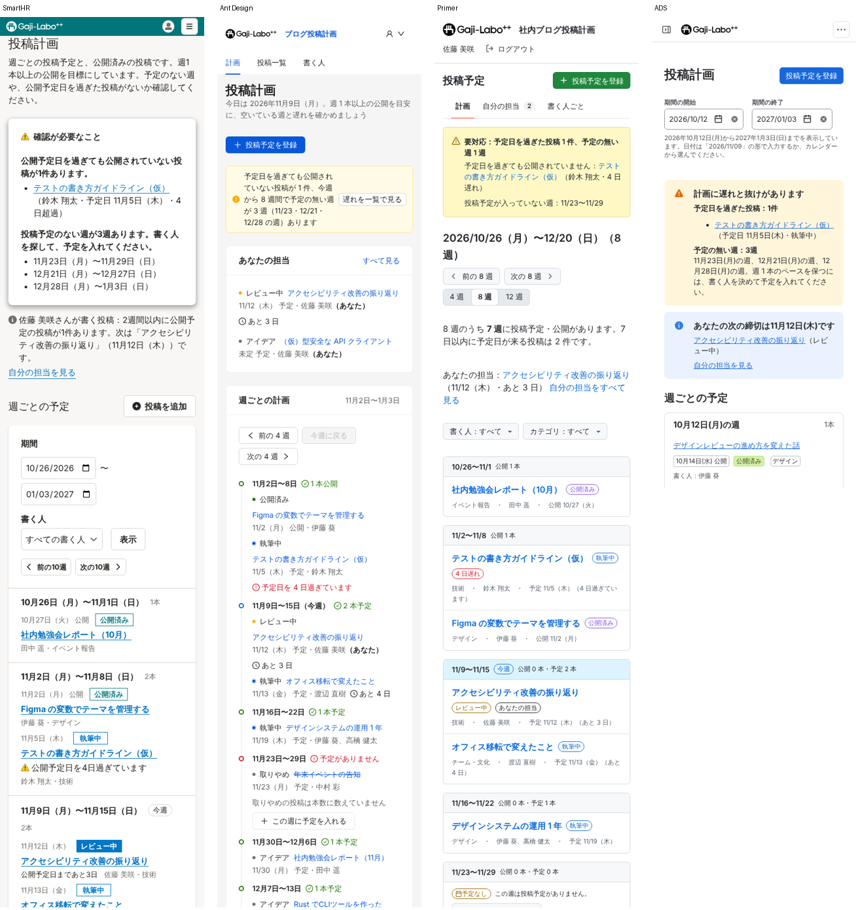

# 情報構造を渡さないブリーフで、ハーネスは情報設計に効くか（社内ブログ投稿計画）

## 実験の設計

- **題材：** 新しい題材「社内ブログ投稿計画」。ブリーフ（[`claude/blog-plan-brief`](../../../tree/claude/blog-plan-brief/brief)）には、**要望・達成したい目標（O1〜O4）・機能要件・固定データだけ**を入れました。
- **書いていないもの：** 画面の分け方、ナビゲーション、何を主役にするか、カレンダーか一覧か、利用者がいつどれだけ開くか。
- **作らせたもの：** 4 つのデザインシステムで、**ハーネスあり**の版を 1 本ずつ作らせました。
  - 情報構造を決める前に、ハーネスの中から画面設計・情報構造・パターンの記述を探して読ませています。
  - SmartHR には、公式サイトの[情報設計](https://smarthr.design/products/information-architecture/)を手順として使わせました。
- **書かせた文書：** 実装の前に `information-architecture.md`（利用者の仮定、オブジェクト、画面とつながり、ナビゲーション、各画面の主役）を書かせ、判断チェックリスト I01〜I20 に根拠と時期を付けさせました。

| デザインシステム | ブランチ |
| --- | --- |
| SmartHR | `claude/smarthr-blog-on` |
| Ant Design | `claude/antd-blog-on` |
| Primer | `claude/primer-blog-on` |
| ADS | `claude/ads-blog-on` |

ハーネスなしの対照版は作っていません。ハーネスが効いたかどうかは、各セッションが挙げた引用の実在と、「読んでから決めたか」の申告で判断しています。

---

## 1. 結論

1. **情報構造を渡さなくても、骨組みはまた 4 つで同じになった。**
   - 中心の対象：投稿（メンバーと多対多）
   - 最初の画面の主役：**週ごとの予定の列**（予定 0 本の週も行として出す）
   - 主役の上：遅れと空き週の知らせ
   - 画面：計画／自分の担当／書く人ごとの 3 つの切り口＋詳細
   - カレンダーとボードは使わない
   - 書く人ごとは表

   4 つとも、**主役の選び方は「自分の判断」**と書いています。根拠はブリーフの目標です。「週 1 本以上のペースで」「投稿予定が入っていない週が分かる」という文から、週の列が導かれていました。
2. **ただし今回は、情報構造の層でハーネスの効き目が見えた。** CT のときと違い、ハーネスが情報構造の「外枠」と「規則」を変えています。違いはデザインシステムごとに大きく分かれました（2 章）。
   - **SmartHR：** 情報設計のガイドが**手順と点検の観点**として効いた。週をオブジェクトにしない、予定と実績を 1 つの「投稿」にまとめる、「投稿を追加」を主ボタンにしない（ページ上の主ボタンは 0）。
   - **Ant Design：** 設計仕様（`docs/spec`）が**画面の型**として効いた。ホームを「ワークベンチ」にする、ナビは項目数で上部かサイドかを決める、階層を浅くする、編集はドロワーで行う。
   - **Primer：** 作成・編集・表示のパターンが**画面の種類の選び方**として効いた。項目数でダイアログか専用ページかを決める、状態を URL に持つ、URL が変わるならタブ型のナビにする。
   - **ADS：** 情報構造にはほとんど効かなかった。効いたのは「タブで画面を切り替えない」と全体の枠組みだけで、情報構造や画面の型の文書は公開されていない。
3. **「何を主役にするか」は、どのハーネスも決めなかった。** 一番近かったのは Ant Design の「ワークベンチ＝利用者がいま注目すべき情報を出すホーム」でしたが、何がそれに当たるかは書いていません。SmartHR の情報設計も「主役の答えは出してくれない。手順と点検には効いた」と報告しています。
4. **ハーネスに素直に従うと、目標から外れる場面もあった。** Ant Design の Calendar の文書は「スケジュールのような日付データには Calendar」と勧めており、そのまま従えば月カレンダーが主役になっていた可能性があります。セッションは目標（週単位のペース、空き週）から判断して採りませんでした。

---

## 2. 情報構造の比較

### 2.1 同じだったところ（4 つに共通）

| 項目 | 共通の答え |
| --- | --- |
| I01 利用者の仮定 | 編集担当は週 1 回（月曜）に遅れ・空き週・偏りを確かめる。書く人は月に数回、自分の担当を確かめて状態を進める。未ログインの人はたまに眺める。主にパソコン、ときどきスマホ |
| I05 最初の画面の主役 | 週ごとの予定の列。0 本の週も出す。上に「要対応」（遅れ・空き週） |
| I07 見せ方 | 週を見出しにしたリスト（Ant Design はタイムライン部品）。カレンダー・ボードは不採用。書く人ごとは表 |
| I09 書く人ごと | 公開済み・予定・最後の公開日・次の予定日の表。予定の無い人を目立たせる |
| I10 遅れと抜け | 行に「n 日過ぎています」、空き週の行に「予定がありません」と「この週に登録」、上部に件数のまとめ |
| I18 権限 | 未ログインは閲覧のみ。一般は自分が書く投稿だけ編集。他人の投稿には「編集できるのは書く人と編集担当」と文で示す |

状態の一覧（`states.json`）でさえ、最初の 6 つ（ログイン中・未ログイン・編集担当・読み込み中・失敗・空）は 4 つで同じ並びでした。

### 2.2 違ったところと、その出どころ

| 項目 | SmartHR | Ant Design | Primer | ADS |
| --- | --- | --- | --- | --- |
| I02 オブジェクト | 投稿・メンバー。**週はオブジェクトにしない**（プロパティ・まとまりの単位） | 投稿・メンバー＋導出した「週」 | 投稿・メンバー＋導出した「週」 | 投稿・メンバー＋導出した「週」（画面では一級扱い） |
| 出どころ | **ハーネス**：情報設計の点検観点「文字列や数値や日付をオブジェクトとしていないか」（`object-model:109`） | 自分の判断 | 自分の判断 | 自分の判断 |
| I04 ナビ | 上部の AppNavi（1 階層） | 上部の横 Menu（3 項目なので上部） | ページ見出し内の UnderlineNav（タブ型） | サイドナビ（タブでの切り替えは禁止） |
| 出どころ | ハーネス（AppNavi） | **ハーネス**：「トップは 2〜7 項目、6 項目超・業務系はサイド」（`research-navigation:108-122`） | **ハーネス**：「タブで URL が変わるなら UnderlineNav」（`navigation.md:95`） | **ハーネス**：「タブで別の画面に移らない」（tabs の usage:37） |
| I12 主ボタン | **ページ上は 0**。「投稿を追加」も補助ボタン | 各画面 1 つ「投稿予定を登録」 | 各画面 1 つ「投稿予定を登録」 | 各画面 1 つ「投稿予定を登録」 |
| 出どころ | **ハーネス**：「［オブジェクトを追加］は一覧画面における主要なアクションにはなりえない」（`visual-guidance.mdx:209`）。事前知識だけなら主ボタンにしていた、と申告 | ハーネス（主ボタンは 1 つ） | ハーネス＋事前知識 | ハーネス |
| I13 登録・編集の形 | モーダル | 右のドロワー | 専用ページ（公開の記録だけダイアログ） | 専用ページ |
| 出どころ | ハーネス＋自分の判断 | 自分の判断（ハーネスは後から裏付け） | **ハーネス**：「数項目ならダイアログ、多ければ専用ページ」（`create.md:29`） | **ハーネス**：「表の中で入力させず、モーダルか専用ページで」（dynamic-table の usage:35） |
| その他の情報構造の判断 | 予定と実績を 1 つの「投稿」にまとめる（概念モデルの点検観点）。遅れ一覧・空き週一覧を別画面にしない（「同じ画面で見たいものが別々の画面にある」問題） | ホーム＝ワークベンチ（`research-workbench:9`）。階層は浅く（パンくず不要）。詳細は URL を共有するため独立ページ（`data-list:121-126`） | 期間・絞り込み・ダイアログを URL に持つ（`view.md:121`）。子ページから親へ戻るリンク | 外枠は top nav＋side nav＋main（layout の usage） |

**まとめ：**
- SmartHR は、情報設計の**点検観点**が対象のモデル化（何をオブジェクトにするか）に直接効いた唯一の例です。
- Ant Design と Primer は、画面の**種類と移り方**の規則が効きました。
- ADS は外枠だけでした。

### 2.3 画面

- 最初の画面（編集担当、1440px）：
- 最初の画面（一般メンバー、1440px）：
- 最初の画面（一般メンバー、390px）：

左から SmartHR、Ant Design、Primer、ADS の順です。骨組みは同じで、外枠に違いが出ています。

| | 外枠 |
| --- | --- |
| SmartHR | 主ボタン無し、見出し領域に「確認が必要なこと」 |
| Ant Design | 右列に「要対応」と「あなたの担当」、タイムライン |
| Primer | タブ |
| ADS | サイドナビ |

---

## 3. SmartHR の情報設計ガイドは手順として効いたか

**効いた。ただし「手順と点検」としてで、「答え」は出さなかった。** 以下は SmartHR のハーネスレポートからの要約で、引用 3 か所は原文と同じ行番号で実在を確認しました。

- **作業の順序そのものになった：** 5 つのアウトプット（業務の説明 → 概念モデル → オブジェクトモデル → ビューの呼び出し関係 → メインナビゲーション）が、`information-architecture.md` の章立てになりました。
- **点検の観点が、モデルの形を変えた：**
  - 「名前の末尾に同じ言葉を持つ概念が複数ないか」（`conceptual-model:130`）→「投稿予定」と「公開済みの投稿」を 1 つにまとめた
  - 「〇〇の▢▢といった概念が登場していないか」→「自分の担当」「予定の無い週」を独立した概念や画面にしない
  - 「文字列や数値や日付をオブジェクトとしていないか」（`object-model:109`）→ 週をオブジェクトにしない
  - 「画面上のレイアウトを示す言葉がオブジェクト名になっていないか」→「計画」をオブジェクトにしない
- **自己点検にも使えた：** 情報設計レビューの観点（概念モデルとオブジェクトモデルの一致、ビューと利用者のストーリーの一致など）で、出来上がった構造を点検しました。
- **答えは出さなかった：**
  - 最初の画面の主役、時間軸の見せ方（週・月・カレンダー）、同じ対象の一覧を 2 つ持ってよいか（計画と自分の担当）は、判断材料が無かった。
  - 「ダッシュボード」や「ホーム」の型も無い。
  - 作成手順の詳細は社内 Notion にあり、外からは読めない。
- **ガイドと目標がぶつかった：** 操作を持たないメンバーは、点検観点に従えばプロパティ扱いです。しかし目標 O2（偏りを減らす）には人ごとの比較画面が要ります。どちらを優先するかの指針はありませんでした。

**この結果の意味：** 情報設計のガイドは、「同じ答えを、より筋の通った構造で出す」ことに効きました。週をオブジェクトにしない、まとめるべき概念をまとめる、主ボタンを置かない、などです。一方で、「別の答え（カレンダーやボードなど）に導く」ことはしていません。

---

## 4. 前回の CT 実験との違い

| | CT（情報構造をブリーフで渡した） | ブログ計画（情報構造を渡さない） |
| --- | --- | --- |
| 骨組みの一致 | 4 つで一致 | 4 つで一致 |
| 主役の出どころ | ブリーフの目標の文（「開いてすぐ」「探さずに」） | ブリーフの目標の文（「週 1 本」「空き週が分かる」） |
| ハーネスが効いた層 | 部品と状態（保存結果の場所、2 択の部品など） | **部品と状態＋情報構造の外枠と規則**（オブジェクトの決め方、ナビの形、編集の場所、主ボタンの方針） |
| デザインシステムごとの差 | 小さい | 外枠の差がはっきり出た |

**わかったこと：**
- **目標の文が、情報構造をほぼ決めている。** 意図を消しても、目標（O1〜O4）と機能要件（「予定が入っていない週が分かる」など）から、モデルは同じ構造を導きました。「意図を入力から外す」ことは、目標を書く限り完全にはできません。
- **ハーネスの情報設計の層は、外枠と規則を変える。** 主役を変えるところまではいきませんが、SmartHR では、対象のモデル化という一段深いところまで効きました。

---

## 5. 示唆

1. **情報設計のガイドは「手順」と「点検の観点」として AI に効く。** SmartHR の点検観点は、そのまま AI のセルフレビューに使えました。自社のデザインシステムで情報設計を持っているなら、**AI 向けハーネスに含めるだけで効果が出る**見込みが高いです。今回、SmartHR の情報設計は公式サイトにあるだけで、プラグインのスキルには入っていませんでした。
2. **どのデザインシステムにも「主役を選ぶ型」が無い。** ホーム、ダッシュボード、個人ビューのような型と、それを選ぶ条件が無いため、主役は目標の文からモデルが決めています。Ant Design の「ワークベンチ」が最も近い例です。前に話した「② 意図を画面の型に結ぶ層」が欠けている、という結論は今回も同じでした。
3. **規範は目標と照らして選ぶ必要がある。** Calendar の推奨（Ant Design）、メンバーをプロパティにする観点（SmartHR）、削除の成功を目立たせない（Primer）など、規範が目標とぶつかる場面がありました。セッションはどれも目標を優先しています。ハーネスに規範の**理由**が書かれているほど、外す判断がしやすくなります。
4. **画面の多様性を見たいなら、目標の書き方か判断者を変える必要がある。** 同じモデルに同じ目標を渡すと、情報構造まで同じになります。

## 6. 公平性の確認

別のエージェントが、4 セッションのツール呼び出しを全件確認しました（計 545 件：SmartHR 160、Ant Design 104、Primer 119、ADS 162）。4 つとも問題はありません。

- **他のブランチ：** 4 つとも、ブリーフのブランチと自分のブランチ以外には触れていません。`git branch -a` の実行もありませんでした。
- **原本と他のセッション：** 原本のリポジトリと、他のセッションの成果物には触れていません。
- **SmartHR が読んだ情報設計の資料：** 公式リポジトリ（kufu/smarthr-design-system）を clone し、その中の `src/content/articles/products/information-architecture/` 配下の記事を読みました。情報設計のトップと、アウトプット 5 種（業務の説明・概念モデル・オブジェクトモデル・ビューの呼び出し関係・メインナビゲーション）です。あわせて、使用性チェックリストと情報設計レビューの記事も読んでいます。Web からの取得は、公式サイトの存在確認とビューの呼び出し関係のページの照合だけでした。
