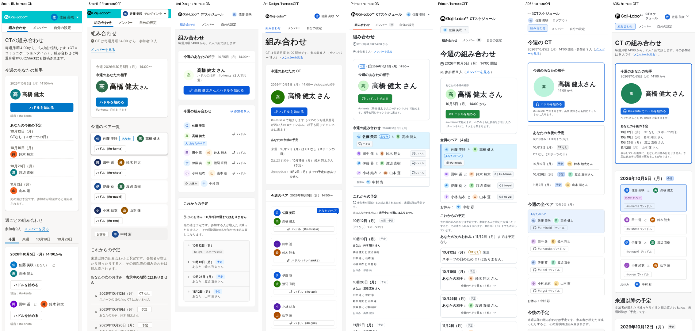
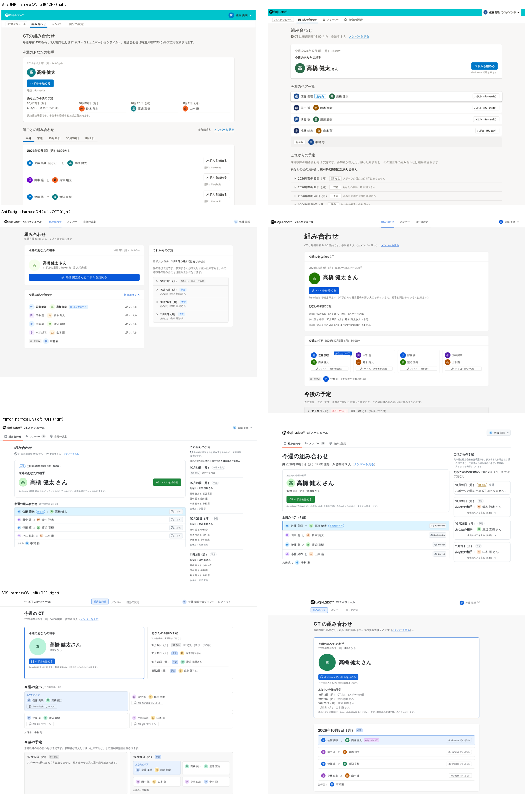
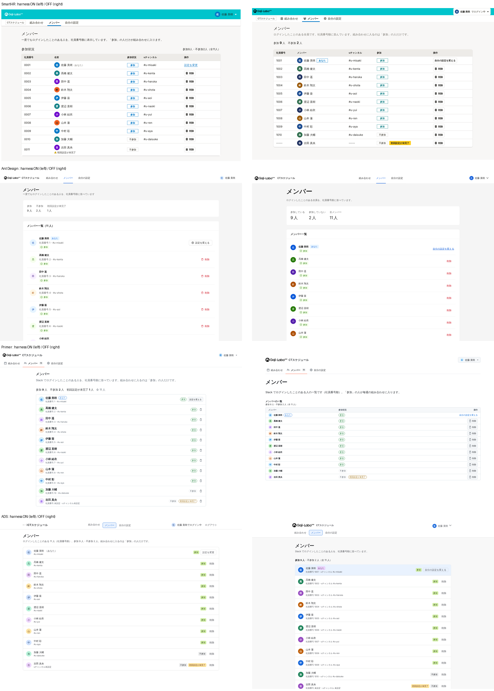
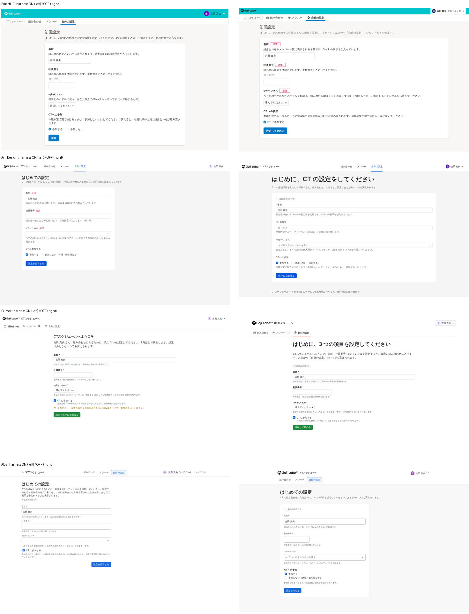

# ハーネスあり／なしの対照実験：ハーネスは何を決めていたか

## 実験の設計

同じブリーフ（[`claude/ct-schedule-brief`](../../../tree/claude/ct-schedule-brief/brief)）・同じモデル・同じデザインシステムで、「ハーネスあり」と「ハーネスなし」の 2 つずつ作りました。4 つのデザインシステムで、合計 8 本です。

| | ハーネスあり（`claude/*-ct-goal`） | ハーネスなし（`claude/*-ct-noharness`） |
| --- | --- | --- |
| 入力 | ブリーフ＋公式ハーネス（MCP、CLI、スキル、llms.txt、DESIGN.md、公式サイトのガイドライン）＋公式 lint | ブリーフ＋npm の部品パッケージ（型定義と同梱の README）＋モデルの事前知識だけ |
| axe・横はみ出し | 直す | 直す（デザインシステムに依らない共通の検査なので） |
| 公式 lint | 実装中に使って直す | 実装を確定させた後に 1 回だけ実行し、**記録だけして直さない**（事後計測） |

8 本とも、同じ判断チェックリスト（D01〜D30）に答えています。各判断について「決めたこと」と「根拠の種類」を書かせ、ハーネスあり版には原文の引用（ファイル・行番号）も付けさせました。

**判定の基準：** ハーネスあり・なしで答えが違い、**かつ**ハーネスあり版が引いた記述が実在する判断だけを、「ハーネスが決めた判断」としました。

---

## 1. 結論

1. **画面の意図（何を主役にし、画面をどう分けるか）は、ハーネスがなくても 4 つすべてで同じになった。**
   - 最上部に「今週のあなたの相手」、主ボタンはハドル開始 1 つ、お休みや祝日の週も同じ場所で言い切る、という構成まで一致しています。
   - G1・G2 の計測値もほぼ同じです。相手の確認は操作 0 回、ハドル開始は 1 回、どちらもスクロールなしでした。
   - **画面の層の意図は、モデルがブリーフから決めています。ハーネスはここに関与していません。**
2. **ハーネスが変えたのは「状態の伝え方」と「フォームの作法」に集中していた。** 次の判断に、ハーネスの具体的な記述がそのまま効いています。
   - 保存結果をどこに出すか
   - 読み込み中・読み込み失敗の見せ方
   - 削除に失敗したときの見せ方
   - 必須の表し方
   - 空の状態の文言
   - モバイルでの一覧の形
   - 2 択の入力部品
3. **効き目の大きさは、モデルの事前知識の少なさに比例した。** ハーネスが決めた判断の数は、SmartHR が 10、Primer が 4、Ant Design が 2、ADS が 2 でした。日本語の、学習データに少ないデザインシステムほど、ハーネスの上乗せが大きくなっています。
4. **「ハーネスを出典に挙げた判断」の大半は、ハーネスがなくても同じだった。** たとえば SmartHR は 30 項目中 24 項目、ADS は 25 項目で、ハーネスを根拠に挙げていました。しかし、実際にハーネスで答えが変わったのは 10 項目と 2 項目だけです。**引用は原因ではなく、多くは後付けの裏付けでした。** ハーネスあり版の自己申告だけでは、ハーネスの効果を測れないことがわかりました。
5. **ハーネスは「そのデザインシステムらしく」するが、「より良く」するとは限らない。**
   - ADS では、ハーネスに従って削除失敗を消える Flag（画面左下）で出しました。ハーネスなし版は、確認モーダルの中でエラーを出してやり直せる形にしており、こちらのほうが使いやすい可能性があります。
   - SmartHR では、ハーネスに従った 404 の画面がヘッダーの無い ErrorScreen になり、現在地が見えなくなりました。
   - 2 択の参加の切り替えは、SmartHR ではハーネスによってラジオボタンになりました。一方 ADS では、ハーネスによってチェックボックスになっています。デザインシステムごとに規範が逆向きです。
6. **検査（lint）は、ハーネスの効果がはっきり見える場所だった。** ハーネスなし版に事後で公式 lint をかけると、SmartHR で 171 件（エラー 86）、Primer で 23 件、ADS で 14 件、Ant Design で 3 件見つかりました。中身は次のとおりです。
   - 見出しレベル、白背景の上に情報パネルを置かない、などの規約
   - 非推奨の API（Ant Design の `List`）
   - モデルの事前知識が古い点（Ant Design v5 の知識のまま）
   - axe では見つからないデザインシステム固有の規約

---

## 2. 判断チェックリストの突き合わせ

### 2.1 ハーネスがあってもなくても同じだった判断（4 つに共通）

| 項目 | 共通の答え |
| --- | --- |
| D01 画面の分け方 | 組み合わせ／メンバー／自分の設定／404（初回設定の扱いだけ揺れた。下記） |
| D02 主役 | 今週のあなたの相手（未ログインならログインの価値の案内） |
| D03 主役の置き場所 | ページ見出しの直下、最大の文字で相手の名前 |
| D04 主ボタン | 1 画面に 1 つ。組み合わせ画面ではハドル開始 |
| D08 先の週は予定 | 各週に「予定」のラベル＋組み直しの説明文 |
| D09 お休み・祝日 | 主役と同じ場所で理由と次の予定を言い切る |
| D12 ナビ | 横並びのタブ型ナビ（各デザインシステムの標準部品） |
| D15 削除の確認 | 確認ダイアログ、danger のボタン、「取り消せません」 |
| D18 参加変更の影響 | 値を変えた瞬間に、保存前の警告 |
| D26 未ログインの案内 | 主役の位置に「ログインすると何ができるか」 |
| D28 文言 | です・ます、ボタンは動詞、見出しは名詞 |
| D29・D30 決まっていないこと | 削除はログイン中の全員（自分以外）、5 週すべて、「次に当たる日」は入れない、参加者数は参加者だけ |

### 2.2 ハーネスが決めた判断（違いが出て、引用が実在するもの）

| デザインシステム | 判断 | ハーネスあり | ハーネスなし | ハーネスの記述 |
| --- | --- | --- | --- | --- |
| **SmartHR**（10） | D07 先の週 | TabBar で週を切り替え | AccordionPanel で開閉 | `page-layout.mdx:36`「ページが過度に長くなることを避ける」→`:56`「ナビゲーションで分割」 |
| | D13 モバイルの一覧 | テーブル→リスト、操作はアイコン 1 つ | 枠を縦に並べる | `page-layout.mdx:355`「テーブルはモバイルに適していません。リストを検討」 |
| | D14 状態の表示 | 参加＝blue、未完了はアイコン付きの文 | 参加＝green、未完了も StatusLabel | `StatusLabel.md:35`「1 つのオブジェクトに複数の StatusLabel を設定しない」 |
| | D17 参加の切り替え | RadioButton（2 択） | Checkbox | `Checkbox.md:73`「2 択の切り替え入力には原則として RadioButton」 |
| | D20 必須の表示 | 「必須」ラベルを省く | RequiredLabel「必須」 | `FormControl.md:138`「すべて必須であることが自明なら省略を検討」 |
| | D21 保存の結果 | 保存ボタンの直下（ResponseMessage） | ページ上部（NotificationBar） | `feedback.mdx:22`「操作部の近くでフィードバックする」 |
| | D23 読み込み失敗 | 本来の場所に NotificationBar（bold） | InformationPanel | `feedback.mdx:562`「特定の要素の表示に失敗した場合」 |
| | D24 空の状態 | 「表示するデータはありません。」 | 「まだメンバーがいません」 | `smarthr-list.mdx:226`「人を指す名詞などで…」 |
| | D25 404 | ErrorScreen（ヘッダーなし） | ヘッダーを残したページ | `feedback.mdx`（ページ全体の失敗）＋component-selector |
| | D28 表記 | 全角と半角の間にスペースを入れない | スペースあり（「Slack でログイン」） | textlint（SmartHR プリセット）で発覚 |
| **Primer**（4） | D16 削除の失敗 | ダイアログ内に Banner critical | 表の上に Banner | `get_pattern-delete:43`「When a deletion fails, keep the dialog open」 |
| | D21 保存の結果 | 保存ボタンの横に InlineMessage | フォーム上部に Banner | `get_pattern-saving:241`「without a redirect … use InlineMessage」 |
| | D22 読み込み中 | 内容の位置に Skeleton、読み上げ 1 回 | Spinner＋文 | `get_pattern-loading:119`「nearest to the content」 |
| | D23 読み込み失敗 | Blankslate（AlertIcon は muted） | Banner critical | `get_pattern-degraded-experiences:103` |
| | （参考）D13 メンバー一覧 | 枠つきリスト（grid） | DataTable（experimental） | 違いはあるが、あり版自身が「自分の判断」と書いているので数えない |
| **Ant Design**（2） | D13 メンバー一覧 | Listy | List（v6 で非推奨） | `antd list`／whenToUse「List component has been deprecated」 |
| | （参考）D20 必須の表示 | 「必須」の文字（既定の * を使わない） | 既定の * | 違いはあるが、「必須」の文字はあり版自身が「日本語の慣習（自分の判断）」と書いているので数えない |
| | D21 保存の結果 | 成功は message、失敗は消えない Alert | どちらも上部の Alert | `spec/feedback.md:124`、research-message-and-feedback |
| **ADS**（2） | D16 削除の失敗 | 消えない Flag（左下） | モーダル内の SectionMessage | Flag の usage「confirmations and alerts」「auto-dismiss しない」 |
| | D17 参加の切り替え | Checkbox | RadioGroup | Checkbox の usage「explicit confirmation (e.g. settings)」 |

### 2.3 ハーネスと関係なく揺れた判断（揺らぎの基準）

同じ条件で 1 回ずつしか作っていないので、ハーネスと無関係にも答えは揺れます。目安として、ハーネスの記述が無いのに答えが分かれた判断を挙げます。

| 判断 | 揺れ方 |
| --- | --- |
| D10 ハドルの場所 | 「社員番号が大きい人」と「小さい人」が、ハーネスの有無と無関係に入れ替わった（SmartHR は両方とも大きい人、Ant Design と Primer はありが大きい人・なしが小さい人、ADS はありが小さい人・なしが大きい人） |
| D19 初回設定 | なし版は 4 つとも専用の `/setup`。あり版は 3 つが「どの画面からも設定フォームへ」。根拠は 4 つとも「ブリーフ＋自分の判断」で、ハーネスの直接の記述ではない |
| D05 ペアの見せ方 | 縦のリストかカードの格子か（Ant Design、ADS） |
| D06 自分のペアの強調 | ラベル、リボン、面の色など |

**この実験の限界：** 各条件 1 回なので、2.2 の判断にも揺らぎが混じっている可能性があります。2.2 は「答えが違う」だけでなく「ハーネスあり版が実在する記述を引いている」ことを条件にして絞りましたが、確定させるには、各条件を 3 回程度くり返す必要があります。

---

## 3. 事後 lint：ハーネスの検査があれば見つかったもの

| デザインシステム | 件数 | 中身（主なもの） | ハーネスあり版 |
| --- | --- | --- | --- |
| SmartHR | **171**（エラー 86・警告 85） | 多言語化の警告 83、既定値と同じ props 22、`Text` の使い方 17、見出しのレベル 6、白背景に InformationPanel 2、`overflow: hidden` 1 など | エラー 0（多言語化の警告 90 は残した） |
| Primer | **23**（うち Primer 固有 14） | `UnderlineNav.Item` の非推奨 props 3、`useResponsiveValue` の禁止 1、CSS のトークン・書式 17 | 0 |
| ADS | **14** | SectionMessage の見出しレベル 10、`` → Image、DropdownMenu の `shouldRenderToParent`、placeholder の禁止、css の書き方 | 推奨設定で 0 |
| Ant Design | **3** | `List` の非推奨（同じ原因で 3 件） | 0 |

- **axe では見つからない規約ばかり**です。4 つのなし版はすべて axe 違反 0 で、lint の指摘は全件、デザインシステム固有の規約でした。
- **Ant Design の配色の対比不足は、ハーネスではなく axe が直した。** あり・なしの両方とも、主ボタンを blue-7 に、状態色を濃い段に下げていました。どちらも axe の結果から直したものです。DESIGN.md も `antd lint` も、この問題を指摘しません。
- **事前知識が古いと、ハーネスの検査が効く。** Ant Design のなし版は「v5 までの知識で、`List` は標準部品」と書き、非推奨を見落としました。型定義にも非推奨の印がありませんでした。ハーネス（CLI）は最新の版の情報を持っています。

---

## 4. 示唆

1. **ハーネスの価値は「部品の層の規範」と「最新の情報」にある。** 画面の層の意図（主役、構成）は、ブリーフとモデルで決まっていました。デザインシステムのハーネスに画面設計の質を求めるのは筋違いで、そこはプロダクト側の文書（ブリーフや DESIGN.md）が担う必要があります。
2. **ハーネスが最も効くのは「状態とフィードバック」の規範。** SmartHR の `feedback.mdx` と Primer のパターン群は、モデルの一般知識（「上部にバナーを出す」）を、より具体的な規範（「操作部の近く」「内容の位置に」）に置き換えていました。自前のデザインシステムで AI 向けハーネスを作るなら、**まずここ（状態ごとに、どの部品をどこに）を書くのが費用対効果が高い**と考えます。
3. **事前知識の少ないデザインシステムほど、ハーネスの効果が大きい。** 社内やローカルのデザインシステム（DADS を含む）では、ハーネスの効果は SmartHR 以上に出るはずです（推測）。
4. **「出典を書かせる」だけでは、ハーネスの効果を測れない。** 出典の自己申告は、実際の効果を 2〜10 倍に見積もっていました。効果を測るには、今回のような有り無しの比較か、少なくとも「読んだ後に決めたか」を時系列で確かめる必要があります。
5. **規範に従うことと、目標を達成することは別物。** ハーネスに従った結果、使いやすさが下がりうる判断がありました（ADS の削除失敗の Flag、SmartHR のヘッダーの無い 404）。ハーネスの規範は、ブリーフの目標と照らして選ぶ必要があります。
6. **検査は「読む」よりも確実で、効果を測りやすい。** 事後 lint の件数そのものが、「ハーネスの検査があれば防げた規約違反」の量です。

---

## 付録 A：画面の比較（左＝ハーネスあり、右＝なし）

- 組み合わせ（390px、8 本並べたもの）：
- 組み合わせ（1440px）：
- メンバー（1440px）：
- 初回設定（1440px）：

## 付録 B：G1・G2 の計測（ログイン中、ページを開いた状態から）

| | あり：名前／ボタンの下端（1440・390px） | なし：名前／ボタンの下端 | 操作回数・スクロール（あり・なし共通） |
| --- | --- | --- | --- |
| SmartHR | 381・445／439・503 | —／342・454 | 確認 0 回・ハドル 1 回・スクロール 0 |
| Ant Design | 277・298／363・398 | 361・422／437・498 | 同上 |
| Primer | 353・381／349・437 | 357・421／— | 同上 |
| ADS | 281・365／375・459 | 381・433／463・515（390 は高さ 844） | 同上 |

（—：その版の文書に値が無かった項目）

## 付録 C：対照セッションの監査

別のエージェントが、ハーネスなし版 4 セッションのツール呼び出しをすべて確認しました（SmartHR 107 件、Ant Design 約 57 件、Primer 約 85 件、ADS 113 件）。

| | 判定 | 内容 |
| --- | --- | --- |
| SmartHR | 問題なし | 読んだのは smarthr-ui の README と型定義だけ。lint は実装をコミットした後に、`src` の複写に対して実行。lint の後に `src` の変更なし |
| Ant Design | 問題なし | CLI で使ったのは `lint` と `--version` だけ。lint の後に `src` の変更なし |
| Primer | 問題なし（軽微な注意 1 件） | 事後 lint の指摘を理解するため、lint パッケージ内の規則の説明文（`no-use-responsive-value.md`）を 1 回読んだ。コードはその後も変えていない |
| ADS | 問題なし | 読んだのは各パッケージの README の冒頭と型定義だけ。lint の後の変更は lint 用の依存と設定、文書のみ |

4 つとも、Web の取得・検索、MCP、公式サイト、スキル、llms.txt、DESIGN.md、原本のリポジトリ、他のブランチ（`git branch -a` を含む）への接触はありませんでした。
