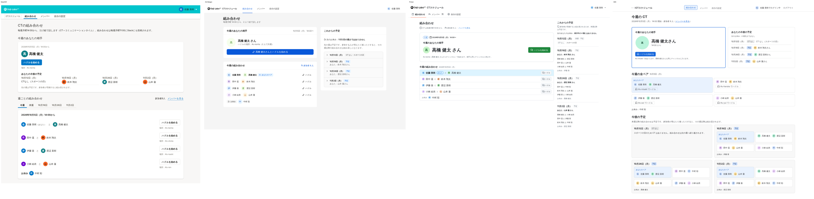
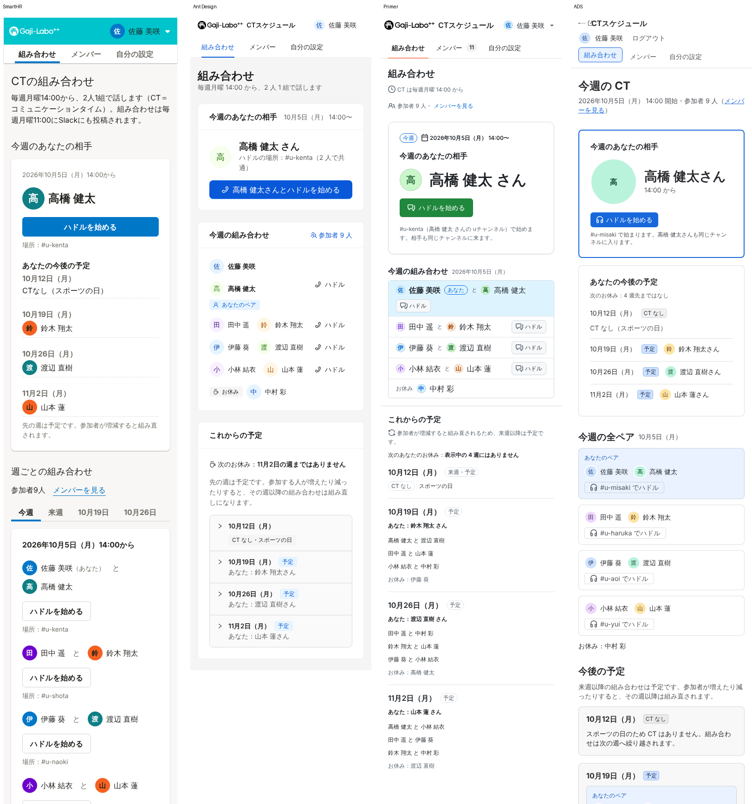
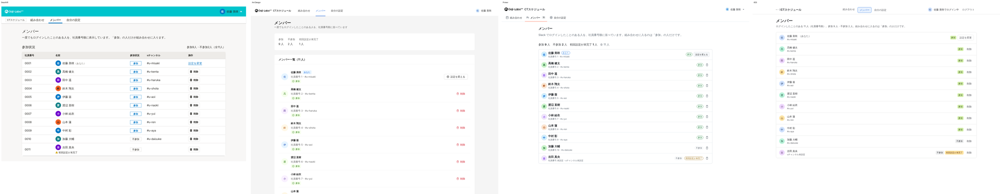
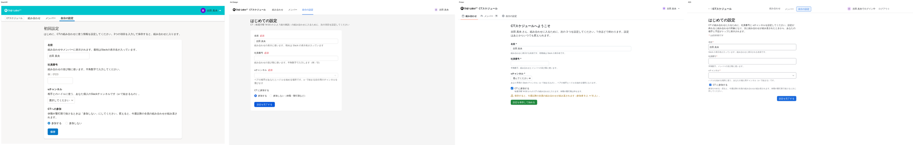

# 要件だけから設計させたときの、4 つのデザインシステムのハーネス比較

同じブリーフ（[`claude/ct-schedule-brief`](../../../tree/claude/ct-schedule-brief/brief) の目標 G1〜G7・機能要件・状態 S01〜S18）を渡し、画面の見本は見せずに、4 つのセッションにそれぞれのデザインシステムで設計・実装させました。各セッションには、設計の前に公式のハーネスを使うよう指示しています。

| デザインシステム | ブランチ | 主な成果物 |
| --- | --- | --- |
| SmartHR | `claude/smarthr-ct-goal` | `smarthr-ct-goal/docs/`（design-decisions／goal-evaluation／harness-report） |
| Ant Design | `claude/antd-ct-goal` | `antd-ct-goal/docs/` |
| Primer | `claude/primer-ct-goal` | `primer-ct-goal/docs/` |
| ADS | `claude/ads-ct-goal` | `ads-ct-goal/docs/` |

この文書で見るのは次の 3 点です。

1. どういう意図でその画面にしたか
2. なぜその画面で目標を達成できると言えるか
3. 各セッションがそれをどう評価したか

見本との類似は問いません。

---

## 1. 結論

1. **画面の骨格は、見本なしでも 4 つともほぼ同じになった。** すべてが次の構成です。
   - 最上部に「今週のあなたの相手」のカード
   - その中に画面で唯一の主ボタン「ハドルを始める」
   - その下か横に、全員のペアと先の週の予定

   4 つのハーネスレポートはそろって、この主役の決め方は**ハーネスからではなく、ブリーフの目標（G1・G2）と自分の判断から来た**と書いています。「どんぐりの背比べ」の原因は見本ではありませんでした。ブリーフの目標の書き方と、同じモデルが判断していることのほうが大きいと考えられます（推測）。
2. **「決まっていないこと」への答えまでほぼ一致した。** 4 つとも次のように決めています。
   - 削除はログイン中の全員に許し、自分自身は削除できない
   - 先の週は固定データの 5 週すべてを見せる
   - 「特定の人と次に当たる日」は入れない
   - 参加者数は参加している人だけで数える

   違いはハドルの場所だけでした。3 つが「社員番号が大きい人の uチャンネル」、ADS だけが「小さい人の uチャンネル」です。
3. **ハーネスが効いたのは「部品の選び方・通知の使い分け・主ボタンは 1 つ・文言・アクセシビリティ」まで。** 画面構成、つまり何を主役にしてどう分けるかの指針は、4 つのどのデザインシステムのハーネスにもありませんでした。
   - SmartHR：パターンは業務オブジェクトの一覧と詳細が前提
   - Ant Design：前提が高密度の業務コンソール
   - Primer：パターンは場面ごとの部品の選び方
   - ADS：画面全体については一般原則（近接・階層）しかない
4. **最も確実に効いたのは「読む」ハーネスより「検査する」ハーネス。** 読んでも見落とした点が、lint や文言検査で見つかりました（SmartHR の textlint で表記違反 50 件、ADS の ESLint で 7 件など）。逆に、検査がデザインまで見ないと抜けが残ります。
   - Ant Design では既定の配色が WCAG AA を満たさず、axe が 375 ノードの違反を出しましたが、`antd lint` は 0 件でした。
5. **評価の方法も 4 つでほぼ同じになった。** 操作回数とスクロール量、最初の画面に何が入るか、状態ごとの文言、ハーネスとの照合、自動検査、の 5〜6 本です。これは私が追加指示に例として書いたものとほぼ一致するので、**評価方法の一致は私の指示による偏り**です。それでも各セッションの工夫には差が出ました（4 章）。

---

## 2. 意図：どういう意図でその画面にしたか

### 4 つに共通する意図

全セッションが同じ因果を書いています。

> 利用者は月曜の CT 前に Slack から来て、数十秒で去る。知りたいことは「今週の自分の相手」ひとつ。→ 全員分のペアから自分を探させず、答えを最上部で 1 つだけ大きく言い切る。→ 相手がわかった直後に押せるよう、そのすぐ下に唯一の主ボタン「ハドルを始める」を置く。→ お休み・祝日・参加者不足の週も、同じ場所で理由と次の予定を言い切る（見る場所を変えない）。

これはブリーフの G1・G2 の書き方（「開いてすぐ」「すぐ通話を始められる」「探さずにわかる」）をほぼそのまま画面にしたものです。

### 違いが出た点

| 観点 | SmartHR | Ant Design | Primer | ADS |
| --- | --- | --- | --- | --- |
| 先の週の見せ方 | 主役カードの中に「あなたの今後の予定」4 週。全員分はタブで週を切り替え（ページが長くなるのを避けるというパターンに従った） | 右の欄に「これからの予定」。週ごとに開閉し、各週の先頭に「あなた：〇〇さん」 | 右の欄（Pane）に 4 週を並べ、各週の先頭に「あなた：〇〇さん」と「次のあなたのお休み」 | 主役の右に「あなたの今後の予定」カード。全員分の先の週は下にカードを並べる |
| 参加の切り替え | **2 択のラジオボタン**（「保存で反映するなら RadioButton」というガイドライン） | チェックボックス＋選んだ直後の警告 | チェックボックス＋直下に「9 人 → 8 人、奇数なので毎週 1 人お休み」 | チェックボックス＋保存前の警告 |
| 主ボタンの色 | 既定の主ボタン色 | 青（主ボタン） | **緑**（Primer の主ボタンは success 色） | 青 |
| ハドルの場所 | 社員番号が後の人 | 大きい人 | 大きい人（自分のペアは「相手の」チャンネルと表示） | **小さい人** |
| 主役の強調 | 文字の大きさと見出し位置 | 相手の名前を見出しにする | 画面で最大の文字 | 太いブランド色の枠＋大きなアバター |

違いは**部品の選び方と見せ方**に出ており、それぞれのデザインシステムのガイドラインに沿っています。たとえば SmartHR のラジオボタンはガイドラインの直接の指示で、Primer の緑の主ボタンはデザインシステムの仕様です。一方で、**何を主役にするかという意図そのもの**には差が出ていません。

### 意図のうちハーネス由来はどれだけか（各ハーネスレポートより）

| | 部品・通知・文言 | 主役を 1 つに絞る | 何を主役にするか・画面の分け方 |
| --- | --- | --- | --- |
| SmartHR | ほぼハーネス（`feedback`、`delete-dialog`、`Button` の must） | ハーネス（「Primary は 1 画面に 1 つ」） | 自分。パターンは一覧と詳細が前提で、「個人の答えを主役にする画面」の型が無い |
| Ant Design | ほぼハーネス（DESIGN.md の Do's and Don'ts、設計仕様、When To Use） | ハーネス（「primary は最重要の 1 操作だけ」） | 自分。DESIGN.md は高密度の業務コンソールが前提で、合わない部分は自分で調整 |
| Primer | ほぼハーネス（19 のパターンが「どの部品を、どこに、どんな文言で」まで具体的） | ハーネス | 自分。「まず要点を見せる」などの一般原則はあるが、何が要点かは決めてくれない |
| ADS | ほぼハーネス（Flag／SectionMessage／Modal の使い分け、フォームの作法） | ハーネス（「主ボタンは 1 セクションに 1 つ」） | 自分。ガイドラインを "dashboard" などで検索しても関係する文書が返らない |

---

## 3. 論証：なぜその画面で目標を達成できると言えるか

全セッションが「目標 → 設計の意図 → 画面の要素 → 証拠」の順で論証しています。G1・G2 の証拠（計測値）は次のとおりです。ログイン中の人が、ページを開いた状態から測っています。

| | 相手の名前の下端（1440／390px） | ハドルボタンの下端（1440／390px） | 相手の確認まで | ハドル開始まで |
| --- | --- | --- | --- | --- |
| SmartHR | 381／445px | 439／503px | 0 操作・0px | 1 回・0px |
| Ant Design | 277／298px | 363／398px | 0 操作・0px | 1 回・0px |
| Primer | 353／381px | 349／437px | 0 操作・0px | 1 回・0px（390×667 でも 0px） |
| ADS | 281／365px | 375／459px | 0 操作・0px | 1 回・0px（キーボードでは Tab 7 回） |

自己評価はどれも G1 が ◎ で、目標全体もほぼ ◎ か ○ でした。違いが出たのは主に G2・G3・G4・G7 です。

| 目標 | SmartHR | Ant Design | Primer | ADS | 評価が分かれた理由 |
| --- | --- | --- | --- | --- | --- |
| G2 | ○ | ◎ | ○ | ◎ | 「Slack 側の手数は測れない」「uチャンネル未設定時に代わりの導線が無い」を減点理由にするかどうか |
| G3 | ○ | ○ | ○ | ○ | 390px では先の週にスクロールが要る、「次のお休み」を 1 行で言えているか |
| G4 | ○ | ○ | ◎ | ○ | 取り消せない削除を「仕様どおり」とみるか課題とみるか |
| G7 | ○ | ○ | ◎ | ◎ | 読み込み中に経過時間や中止の手段が無いことを課題とみるか |

**目標の達成度そのものには、デザインシステムによる大きな差は出ていません。** ◎と○の差は、画面の差というより減点の付け方の差です。

---

## 4. 評価の方法：それぞれどう評価したか

### 共通の骨格

4 つとも、ほぼ同じ物差しを自分で定義しました。操作回数とスクロール量、最初の画面に何が入るか、状態ごとの「何が起きたか＋次の行動」、ハーネスとの照合、自動検査（axe・横はみ出し・公式 lint）です。この骨格は私の追加指示の例と一致するので、**ここは独立した判断とは言えません**。

### セッションごとの工夫

| | 独自に加えた評価 | 評価の厳しさ |
| --- | --- | --- |
| SmartHR | **操作の自動確認**（Playwright でハドル・初回設定・参加の変更・削除・ロゴの別タブを実際に操作し、結果の表示を確かめる）。エラー文を SmartHR の「事象・原因・対処」の型で照合 | G2 を ○ にするなど、デモでは測れない部分を減点理由にしている |
| Ant Design | **評価記号の付け方を明文化**（A・B・C を満たし E で違反が無ければ ◎）。状態一覧に無い G5 の画面を追加で撮影・計測。主要な操作の通り道 12 項目を自動テスト | 基準が明確な分、◎ が付きやすい |
| Primer | **端末の高さを 390×667（小さめのスマホ）まで下げて計測**。物差しに「機能要件との突き合わせ」を加え、要件の抜けを確認。G3 の位置も追加で計測 | 「残る課題が目標の外か内か」で ◎／○ を分けるという、根拠のはっきりした基準 |
| ADS | **キーボードで Tab 何回でハドルに届くか**を計測。行き止まりの数（0）を数えた | ガイドラインの「行き止まりを作らない」をそのまま評価基準にした |

### 評価の限界（4 つとも書いている）

挙げた項目はほぼ共通です。

- 実ユーザーでの検証をしていない
- スクリーンリーダーでの確認をしていない（axe のみ）
- キーボードだけで最後まで操作していない
- 実機と Slack アプリ内のブラウザで確かめていない
- 設計した本人が評価しているので偏る

SmartHR は対策として「設計に関わっていない人（または別のエージェント）に、目標だけを渡してスクリーンショットを評価させる」を挙げています。今回の比較でもこれは未実施です。

---

## 5. ハーネスの使い勝手（このセッションたちが実際に触ってわかったこと）

| | 入口と起動条件 | 効いたもの | 問題 |
| --- | --- | --- | --- |
| SmartHR | スキル 2 つだけ（MCP・llms.txt・DESIGN.md は無い）。スキルの起動条件は「smarthr-ui を import する TSX を書くとき」で、**画面を設計する段階では起動しにくい** | 部品の must/should/avoid、`feedback`（状態ごとの通知の部品）、`delete-dialog` の定型。選定表から迷わず該当ファイルに行けた | 文言の規則はスキルに入っておらず、textlint で初めて 50 件わかった。ヘッダーなどが SmartHR のロゴ・文言で固定。このセッションではプラグインを入れられなかった |
| Ant Design | CLI（`antd info/demo/token/lint`）と DESIGN.md。スキルの起動条件は「部品を書く・調べる」で、**画面構成や文言を決めることは含まれない** | 「primary は 1 つ」、非推奨 props の確認、通知の使い分け | **既定の配色が WCAG AA を満たさない**（axe 違反 375 ノード）のに、DESIGN.md は主ボタンの対比不足しか書いておらず、`antd lint` は 0 件。`antd lint` は API の検査で、DESIGN.md の Don'ts（主ボタンの 2 つ並びなど）は検出しない。スキルと MCP の自動設定は環境の権限で拒否された |
| Primer | MCP 20 ツール。トークン系のツールは説明文が命令形で強い（「CRITICAL: CALL THIS FIRST」）が、**パターン系は起動条件が弱い**（価値は一番高いのに） | 19 のパターン（削除・保存・通知・空の状態・読み込み・フォームなど）が具体的 | 部品の使い方を取るツールが 52 回中 16 回、中身の代わりにサイトのトップページを返した（エラーにならない）。`lint_css` は設定が無いと理由を出さずに失敗。`review_alt_text` は判定せず質問を返すだけ |
| ADS | llms.txt → MCP／CLI の流れが明確。a11y ツールは説明文に「UI を作るときは必ず呼ぶ」とある | 通知の使い分け、フォームの作法、Lozenge は色＋文字、lint 7 件の指摘 | 部品の使い方の指針が `ads_get_all_components`（全件・約 55 万字）の中にしか無く、通常の検索では手に入らない。ハーネスの情報とパッケージの実体がずれる箇所が多い（推奨の読み込み口、React 19 対応、lint の修正案など） |

---

## 6. 見本ありの再現版との比較（補助）

最初の 3 セッション（`claude/*-ct-schedule`）と前回の ADS 版（`ads-ct-schedule/`）は、原本の画面を見て再現したものです。

- **意図の言語化**：再現版への指示は「原本と同じ画面を作り、迷ったら原本の design-decisions に合わせる」でした。私が書いた前回の ADS 版の design-decisions も、原本の意図を ADS でどう表すかが中心です。要件だけの版では、意図を「利用シーン → 目標 → 画面の要素」の因果として、各セッションが自分で書いています。
- **評価の仕方**：再現版への指示は「原本と並べて撮影し、再現度を評価する」でした。要件だけの版は、目標ごとの計測と論証です。ただし、評価の物差しは私の指示が形づくったものです。
- **画面の骨格**：見本ありでもなしでも、ほぼ同じでした（最上部に自分の相手、主ボタンでハドル）。**見本を隠しても画面の多様性は増えませんでした。**

※再現版の各レポートは、今回は要点しか読んでいません。

---

## 7. 示唆

1. **デザインシステムのハーネスは「部品の層」の意図を運ぶが、「画面の層」の意図は運ばない。** 今回の 4 つはどれも、「この画面で何を主役にするか」を判断する材料を持っていませんでした。画面の層の意図は、プロダクト側（ブリーフや design-decisions）が書くしかありません。そして今回は、それを書いたブリーフが画面をほぼ決めていました。
2. **デザインシステムの差を見たいなら、比べる層を変える必要がある。** 画面の骨格ではなく、次の層で比べると差が出ます。
   - 部品の選び方（SmartHR のラジオボタン、Primer の緑のボタン）
   - 状態の伝え方
   - 文言の型
   - 既定値の品質（Ant Design の対比不足）
3. **画面の多様性を出したいなら、ブリーフの目標を「解き方の自由度」が残る書き方にするか、判断する主体を変える。** 解き方を残すとは、たとえば「探さずにわかる」と書かずに、利用者の状況だけを書くことです。主体を変えるとは、別のモデルや人間のデザイナーに任せることです。同じモデルに同じ目標を渡すと、同じ答えに収束します。
4. **評価は第三者に任せるべき。** 4 つとも自己評価で、物差しは私の例に引っ張られていました。次は、設計に関わっていないセッションに目標と 4 つのスクリーンショットだけを渡して評価させるのがよいと考えます。デザインシステム名は伏せます。
5. **ハーネスは「読ませる」より「検査させる」。** 起動条件が弱い文書型のハーネスは、指示が無いと設計段階では読まれません。4 つとも自発性は検証できず、「指示されたから読んだ」と書いています。lint は必ず効きますが、検査範囲が API だけだと（Ant Design）デザインの抜けを見逃します。

---

## 付録：公平性の確認（見てはいけないものに触れていないか）

別のエージェントが、4 セッションのツール呼び出しをすべて確認しました（SmartHR 140 回、Ant Design 130 回、Primer 115 回、ADS 211 回）。

| | 判定 | 内容 |
| --- | --- | --- |
| SmartHR | 問題なし（ブランチ名のみ見えた） | `git branch -a` を 1 回実行。外部の参照は kufu/smarthr-design-system と smarthr.design のみ |
| Ant Design | 問題なし（同上） | `git branch -a` を 1 回実行。外部の参照は ant.design のみ |
| Primer | 問題なし（同上） | `git branch -a` を 1 回実行。外部の参照は npm と primer.style のみ |
| ADS | 問題なし（同上） | `git branch -a` を 1 回実行。外部の参照は atlassian.design のみ |

4 つとも、原本のリポジトリ（digital-go-design-system）には触れていません。他のブランチの中身を読んだ記録もありません。読んだファイルはすべて、自分の作業フォルダか一時フォルダの中でした。`git branch -a` でブランチの名前は見えていますが、中身は開いていません。

## 付録：画面の比較

左から SmartHR、Ant Design、Primer、ADS の順です。

- 組み合わせ画面（1440px）：
- 組み合わせ画面（390px）：
- メンバー画面（1440px）：
- 初回設定（1440px）：
